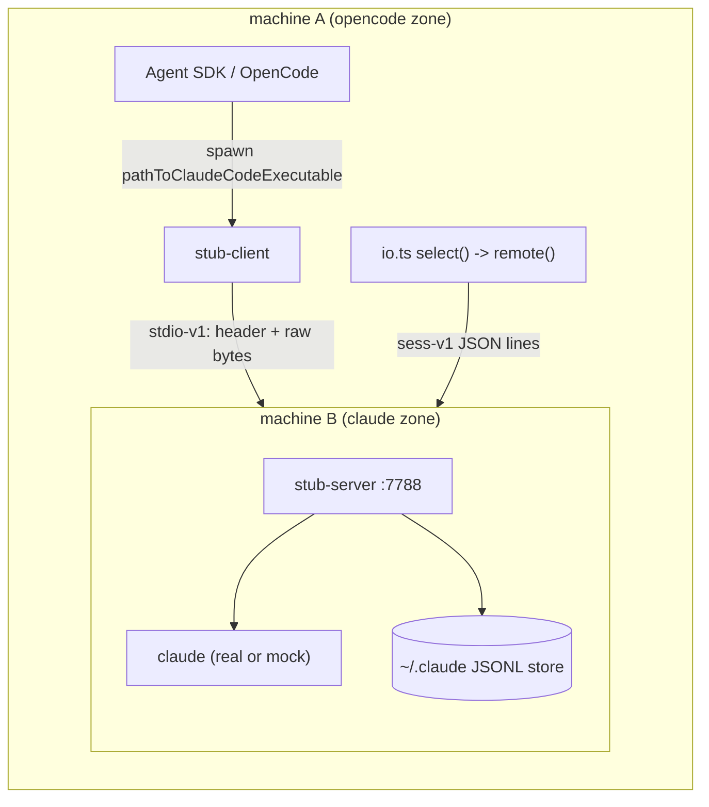

# claude-io-stub

C/S stub pair that lets OpenCode (machine **A**) drive a `claude` binary
running on machine **B**: stdio relay + session-store projection + MCP, in
Rust. Lab prototype for validating the split of OpenCode's `claude-agent`
provider across two Docker containers.

## Constraints as implemented

| Constraint | Implementation | Proof |
| --- | --- | --- |
| C/S only — B never dials A | `stub-server` only `accept()`s; there is no outbound `connect` in the binary | `scripts/assert-nodial.sh` fails if the server owns any ESTAB connection whose local port is not the listen port (runs in both e2e suites) |
| Multiple clients, one server | Every stdio connection gets its own `claude` child process (argv/env/cwd come from that connection's hello header); session RPC is stateless over a shared, mutex-guarded store | e2e runs 3 concurrent SDK drivers with distinct sessions through one server, plus 3 concurrent forks of one source |

## Verified (2026-11-01)

- `cargo test`: 4/4 (env allowlist; store exists/messages/delete; fork prefix+fresh-ids+chain; fork error paths)
- `scripts/run-e2e-native.sh`: PASS on 127.0.0.2 (B) vs default zone (A) — basic turn, MCP round trip, 3 concurrent clients, sess RPC, file-level fork verification (`verify-fork.py`: 3 lines, chain consistent), 3 concurrent forks -> 3 distinct sessions, no-dial assertion via `ss`
- `scripts/run-e2e-docker.sh`: PASS across two containers (service `a` -> `b:7788`), same suite, and the no-dial assertion executed inside container `b` against pid 1
- ShellCheck: clean on all scripts
- `WIRING=deepseek scripts/run-e2e-docker-real.sh`: PASS — real claude **2.1.316** (native build, container `b`) answering through `api.deepseek.com/anthropic` with `deepseek-flash`; marker echo, real JSONL in B's store, RPC fork of the real store, and **`--resume <forked-id>` through the stub reproducing the parent session's marker** (cross-process context continuity), delete + no-dial clean
- ws-line-v1 full stack: real-claude e2e over **WS stdio + HTTP store + WS MCP tunnel** (marker echo, HTTP store ops, fork+resume continuity, real `mcp__lab__read_work_file` call on a file that exists only on machine A, no-dial clean); mock suites (native + docker) regression PASS

## Real-claude mode (docker)

`scripts/run-e2e-docker-real.sh` boots machine B with the genuine `claude`
binary (native installer, v2.1.316) and drives a non-Anthropic model backend
through the relay. Wiring comes from `~/.omp/agent/models.yml` via
`mock/wiring-env.py`, selected with `WIRING`:

| WIRING | ANTHROPIC_BASE_URL | credential source | model |
| --- | --- | --- | --- |
| `deepseek` (default) | `https://api.deepseek.com/anthropic` (official DeepSeek <-> Claude Code integration) | `providers.deepseek.apiKey` | `deepseek-flash` |
| `anthropic` | models.yml `providers.anthropic.baseUrl` (anthropic-messages gateway) | `providers.anthropic.apiKey` | gateway-routed claude names |

Credentials travel only as container env -> stub hello header (the
`ANTHROPIC_*`/`CLAUDE_*` allowlist) -> claude child env on B; they are never
written to the repo or printed. The suite asserts:

1. turn 1: the model echoes a marker phrase back through A -> B -> DeepSeek,
2. the real JSONL session lands in B's store (RPC `exists`/`messages`),
3. RPC `fork` on the REAL store, then real claude `--resume <forked-id>`
   through the stub reproduces the marker — cross-process context continuity,
4. cleanup + no-dial assertion on B.

Real-claude quirks handled by the driver: `[claude-code:unrecognized_model]`
warnings are printed on **stdout** next to protocol JSON (skipped), and
`--verbose` stream-json re-emits `init` (the user turn is fed once).

## Tool use / MCP

**Production answer:** in the OpenCode integration, tool execution stays on
machine A by construction. The provider replaces claude's built-in tools and
surfaces ALL of OpenCode's tools — built-in plus every MCP server configured
on the OpenCode side — as the single `mcp__opencode__*` MCP server, bridged
over the same stdio control channel the relay already carries. Adding more MCP
servers or tools on the OpenCode side requires **zero stub changes**; claude's
own MCP servers/skills on B are never loaded (OpenCode's isolation env).

**Lab proof (implemented & verified, `--mcp` driver mode):** claude's
`--mcp-config` spawns a stdio MCP server on B; that helper dials **B's own
loopback** and gets paired with a pre-opened A-initiated tunnel:

1. driver (A) opens `WS /v1/tunnel?side=a` to the stub-server — queued;
2. claude (B) spawns the configured stdio helper
   `stub-client tunnel --url ws://127.0.0.1:7789/v1/tunnel?side=b` — dialing
   **B's own loopback**, never A's address; the server pairs it with the
   queued tunnel;
3. the helper's WS frames are the MCP server's stdio on A
   (`driver/mini-mcp-server.mjs`, zero-dependency JSON-RPC).

The real-claude e2e proves A-side execution: claude calls
`mcp__lab__read_work_file("/work/secret.txt")`, and the file exists **only on
A** — the model can only reply with its content because the tool ran there.
`ENABLE_TOOL_SEARCH=false` is required (mirrors OpenCode's isolation: without
it claude 2.1.316 hides MCP tools behind its ToolSearch meta tool). Adding
more tools: extend `TOOLS` in `mini-mcp-server.mjs`; adding more stdio
servers: more `mcpServers` entries + one queued tunnel each.

## ws-line-v1 protocol (HTTP/WS listener)

`--http-listen HOST:PORT` adds a second, gateway-friendly listener (raw TCP
`--listen` stays available and both share the same store/process state):

| Endpoint | Shape | Notes |
| --- | --- | --- |
| `GET /v1/store/sessions/{id}` | HTTP JSON | `{"exists":true}` / 404 |
| `GET /v1/store/sessions/{id}/messages` | HTTP JSON | `{"ok":true,"messages":[...]}` |
| `POST /v1/store/sessions/{id}/fork` | HTTP JSON, body `{"upTo":uuid}` | `{"sessionId","pairs","messages"}` |
| `DELETE /v1/store/sessions/{id}` | HTTP JSON | `{"deleted":bool}` |
| `WS /v1/stdio` | text frame = one protocol line | first frame: hello `{"proto":"stdio-v1",argv,env,cwd}` → ack `{"ok":true}`; control frames use the `{"proto":...}` namespace (`stdin-eof` closes the child's stdin) |
| `WS /v1/tunnel?side=a\|b` | text frame = one MCP JSON-RPC line | side=a queues (A-initiated), side=b pairs (B-loopback helper) |

Binary frames are a protocol violation (server warns and ignores). Optional
`--http-token TOKEN` enforces `Authorization: Bearer` on every route — put
your CF Access / oauth2-proxy / mTLS in front of this listener and the stub
inherits gateway auth, device management and TLS for free.

Implementation traps recorded the hard way: build with
`rust:1-slim-bookworm` (rolling `rust:1-slim` is trixie; its binary then
needs GLIBC_2.39 that bookworm lacks and the server hangs half-started);
tokio's `ChildStdin::shutdown()` only flushes, it does NOT close the pipe —
real EOF for claude requires dropping the write end; claude's
`[claude-code:...]` warnings arrive on stdout between protocol frames.

## Topology



MCP needs no separate channel: OpenCode's `type: "sdk"` MCP server runs inside
the SDK host, and tool calls ride the same stdio control protocol. The relay is
byte-transparent, so the MCP round trip is covered by the stdio path — the e2e
asserts a full `tool_use -> tool_result -> assistant` exchange through both
containers.

## Wire protocol

Connection type is chosen by the first line the client sends.

**stdio-v1** (one per claude process)

```
A->B  {"proto":"stdio-v1","argv":[...],"env":{...allowlisted...},"cwd":"..."}
B->A  {"ok":true}                        // or {"ok":false,"error":...}
A<->B raw bytes: A-stdin -> child.stdin, child.stdout -> A-stdout
```

* `env` is an allowlist (`ANTHROPIC_*`, `CLAUDE_*`, `DISABLE_*`, `ENABLE_*`,
  `MCP_*`, `MAX_MCP*`, `SSL_CERT*`, `REQUESTS_CA*`, `CURL_CA*`, plus
  `HTTP(S)_PROXY`, `NO_PROXY`, `ALL_PROXY`, `API_TIMEOUT_MS`) — see `src/envf.rs`.
* The server pins `CLAUDE_CONFIG_DIR` to `--store` for the child, so a real
  `claude` writes its session JSONL where the projection RPC reads.
* Child stderr is NOT multiplexed into the pristine stdio stream; it goes to
  `--log-dir/stderr-<conn#>.log`. Child exit codes are not propagated (the
  Agent SDK communicates outcomes via protocol JSON); the client exits 0 after
  the relay, non-zero only on connect/ack failure.
* When A closes the socket, B closes the child's stdin and `kill_on_drop` is
  armed — no orphaned claude processes.

**sess-v1** (stateless request/response, JSON lines)

| op | request | response |
| --- | --- | --- |
| exists | `{"id":1,"op":"exists","session":"S"}` | `{"id":1,"ok":true,"exists":bool}` |
| messages | `{"id":1,"op":"messages","session":"S"}` | `{"ok":true,"messages":[...]}` |
| fork | `{"id":1,"op":"fork","session":"S","upTo":"uuid"}` | `{"ok":true,"sessionId":"new","pairs":[[old,new]...],"messages":[...]}` |
| delete | `{"id":1,"op":"delete","session":"S"}` | `{"ok":true,"deleted":bool}` |

## Session store format (projection backend)

`<store>/projects/**/<sessionID>.jsonl`, one JSON object per line with at
least `uuid`, `sessionId`, optional `parentUuid`, plus payload fields. `fork`
mirrors the Agent SDK semantics: copy the prefix up to and including `upTo`,
assign a fresh session id, fresh uuids for every copied line, rewrite the
`parentUuid` chain (first line keeps its original parent), leave the source
untouched. Unit-tested in `tests/store.rs`.

**Production note:** this is a re-implementation for the lab. For a real
deployment the fork should be executed by the Agent SDK on machine B instead;
the RPC surface exists so machine A never touches B's filesystem.

## Run it

Native (B emulated on 127.0.0.2, the second loopback address):

```bash
cd claude-io-stub
scripts/run-e2e-native.sh
```

Covers: basic turn, MCP round trip over the relay, 3 concurrent clients on one
server, sess RPC (exists/messages/fork/delete), file-level fork verification,
3 concurrent forks, and the no-dial assertion.

Docker (two containers, one network, B named `b`):

```bash
cd claude-io-stub
scripts/run-e2e-docker.sh
```

`docker compose run a` executes the same suite against `b:7788`, then the
no-dial assertion runs inside container `b` (pid 1 = stub-server).

Manual poking:

```bash
export CLAUDE_STUB_ENDPOINT=127.0.0.2:7788
stub-client sess fork session_aaa u-aaa-2   # pretty JSON, exit 2 on rpc error
```

## Hooking into OpenCode

`opencode/claude-io-remote.patch` (reference, targets branch `dev`):

1. Adds `remote()` / `select()` to `packages/core/.../claude-agent/claude/io.ts`
   — sess RPC in TS via `node:net`, `spawn` left undefined.
2. Flips `index.ts` to `make(ClaudeIO.select())`.

On machine A set:

```bash
export CLAUDE_STUB_ENDPOINT=b:7788
export OPENCODE_CLAUDE_PATH=/usr/local/bin/stub-client   # what the SDK spawns
```

Login/probe/status/model-list all flow through the same relay: `ClaudeProbe`
opens a `query()` which spawns stub-client like any other session.

## Security / limitations

* The stub port is a remote-code-execution surface (A controls argv, cwd and
  the claude binary's env). No auth, no TLS — bind it to a private network
  only. This is a lab tool.
* Store locking is one global mutex (correct, not fast). JSONL layout is an
  assumption; pin claude versions on both ends of a real experiment.
* No transport-level session multiplexing: one TCP connection per claude
  process and one per RPC request batch. Concurrency comes from the server
  accepting many connections, which matches the SDK's one-process-per-session
  model anyway.
* Exit codes and child stderr are not transported (see above).
* Fork is re-implemented in Rust rather than delegated to the Agent SDK on B
  (see production note above).

## Layout

```
src/bin/stub-server.rs   accept loop, sess RPC, per-connection claude spawn + relay
src/bin/stub-client.rs   transport mode (SDK-facing) + sess one-shot CLI
src/proto.rs             line framing + hello parsing (byte-wise, no over-read)
src/envf.rs              env allowlist
src/store.rs             JSONL session store + SDK-semantics fork
tests/store.rs           fork/exists/messages/delete unit tests
mock/claude-mock.py      minimal stream-json claude (incl. MCP tool_use)
driver/sdk-driver.mjs    SDK-side protocol driver used by both e2e suites
scripts/                 e2e runners + no-dial assertion
docker/                  Dockerfile (server/client targets), entrypoint
opencode/                reference patch for OpenCode's claude-agent provider
```
